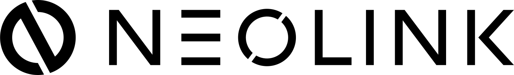

<p align="center">
  
</p>

<p align="center">
  <a href="https://github.com/GrowlyX/neolink/actions/workflows/ci.yml"></a>
  <a href="https://github.com/GrowlyX/neolink/releases/latest"></a>
  
  <a href="LICENSE"></a>
</p>

# Neolink

A native display manager for macOS, written in Rust. Neolink brings display arrangement, virtual screens, and DisplayLink controls into one app. Its UI is built with GPUI, and its display operations use CoreGraphics.

> **Early development:** Neolink is pre-1.0. The DisplayLink USB transport is reverse engineered and has not been validated with hardware. Review [COMPATIBILITY.md](COMPATIBILITY.md) before using it with a dock.

## What you can do

- See connected displays and arrange them by dragging their cards on the canvas.
- Change display modes, choose the main display, mirror screens, and save or tidy a layout.
- Create and configure virtual displays, including resolution, HiDPI backing, and rotation.
- View DisplayLink device details and adjust brightness, contrast, and enable/flip state when the vendor agent is available.
- Fetch and install the official DisplayLink package on demand. Neolink does not bundle Synaptics software or firmware.
- Set the app appearance, configure launch at login, and open macOS privacy settings for Screen Recording and Accessibility.

Monitor maker marks are shown when the connected display name matches a known brand. Neolink uses the [Feather](https://github.com/feathericons/feather) icon set and Geist typeface.

## Install

Neolink requires macOS 14 or newer. Download the latest app bundle from [GitHub Releases](https://github.com/GrowlyX/neolink/releases/latest). The bundle is universal and currently ad-hoc signed; macOS may require you to remove quarantine or approve the app in System Settings on first launch. See [Development](docs/DEVELOPMENT.md#releasing) for release signing details.

A real DisplayLink dock may also need the vendor driver. You can install it from the app with **Get DisplayLink**, or use the CLI:

```sh
neolinkctl vendor provision
```

Neolink fetches the official package at runtime, verifies its pinned SHA-256, and invokes the macOS installer when you request installation. Package cache commands include `vendor status`, `vendor expand`, `vendor packs`, and `vendor purge`.

## Build and run

Install the Xcode command-line tools, Rust toolchain, and the macOS SDK, then run:

```sh
cargo run -p neolink
```

Build the app bundle with:

```sh
scripts/bundle.sh --release
# target/release/Neolink.app
```

For the development workflow, CI checks, and release process, see [docs/DEVELOPMENT.md](docs/DEVELOPMENT.md).

### Demo mode

`NEOLINK_DEMO=1` creates a virtual display when the app starts. `NEOLINK_DEMO=2` also exercises the display action paths and saves a demo layout. These modes change the local macOS display configuration; close or remove the demo display when finished.

```sh
NEOLINK_DEMO=1 cargo run -p neolink
```

## Architecture

| Crate | Responsibility |
| --- | --- |
| `neolink-app` | GPUI app: settings, display arrangement canvas, inspector, and user actions |
| `neolink-core` | CoreGraphics display management, virtual screens, layout persistence, vendor agent/XPC, USB transport, and on-demand package installer |

Useful source areas:

```text
crates/neolink-app/src/                 Native UI and app state
crates/neolink-app/assets/              Neolink marks, Feather settings icon, Geist fonts, brand logos
crates/neolink-core/src/displays.rs     CoreGraphics enumeration and reconfiguration
crates/neolink-core/src/virtual_display.rs  CGVirtualDisplay engine
crates/neolink-core/src/layout.rs       Layout profiles and persistence
crates/neolink-core/src/agent.rs        Vendor agent supervision and XPC
crates/neolink-core/src/transport.rs    DL3 USB transport
crates/neolink-core/src/vendor.rs       Pinned package fetch, verify, and install
```

## Brand assets

The approved Neolink logo kit is included under [`crates/neolink-app/assets/brand/`](crates/neolink-app/assets/brand/):

- Mark: [black](crates/neolink-app/assets/brand/neolink-mark-black.svg) · [white](crates/neolink-app/assets/brand/neolink-mark-white.svg)
- App icon, white mark on black square: [neolink-icon.svg](crates/neolink-app/assets/brand/neolink-icon.svg)
- Lockup: [black](crates/neolink-app/assets/brand/neolink-lockup-black.svg) · [white](crates/neolink-app/assets/brand/neolink-lockup-white.svg)
- Wordmark: [black](crates/neolink-app/assets/brand/neolink-wordmark-black.svg) · [white](crates/neolink-app/assets/brand/neolink-wordmark-white.svg)

## Limitations

The virtual-display and arrangement paths work locally. The USB transport has not been tested against a physical dock, and the frame capture/encode path is not connected yet. HDCP support and notarized distribution are also not implemented. The compatibility matrix and validation notes are in [COMPATIBILITY.md](COMPATIBILITY.md).

## License and trademarks

Neolink code is MIT licensed. Neolink redistributes no Synaptics DisplayLink binaries, drivers, or `.spkg` firmware; those remain subject to their owners’ terms and are downloaded from the official source when requested. Manufacturer marks identify display vendors and do not imply endorsement; their sources and notes are in [`crates/neolink-app/assets/brands/SOURCES.md`](crates/neolink-app/assets/brands/SOURCES.md). Geist is distributed under the SIL Open Font License; see [`crates/neolink-app/assets/fonts/OFL.txt`](crates/neolink-app/assets/fonts/OFL.txt).

## Project docs

- [Compatibility and validation](COMPATIBILITY.md)
- [Development and CI](docs/DEVELOPMENT.md)
- [Reverse engineering findings](docs/RE-FINDINGS.md)
- [Contributing](CONTRIBUTING.md)
- [Security policy](SECURITY.md)
